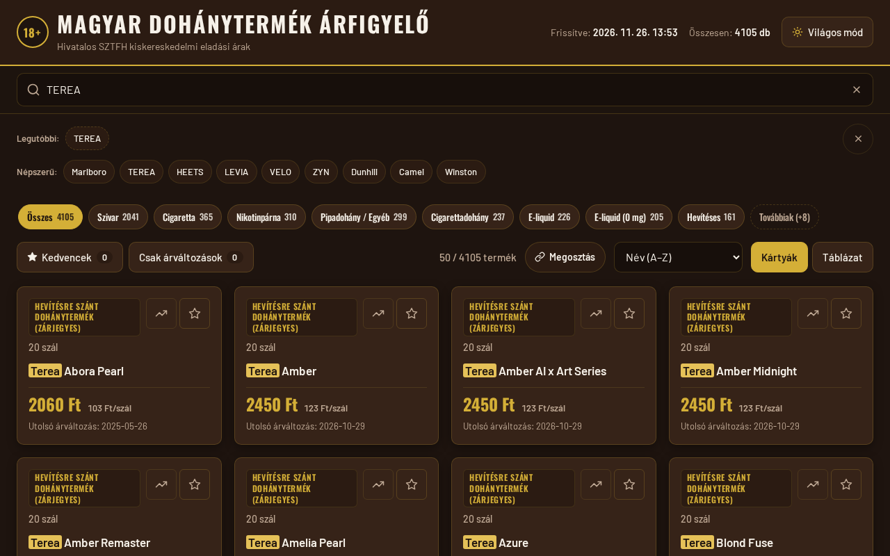
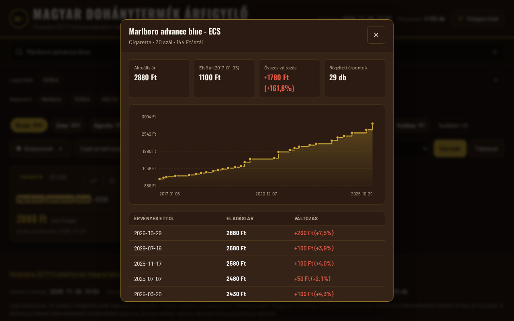
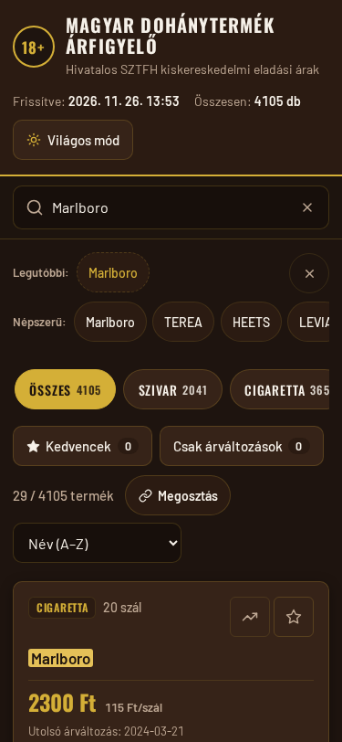

# Magyar Dohánytermék Árfigyelő

Statikus, keretrendszermentes webalkalmazás és automatizált **GitHub Actions** adatfrissítő folyamat a magyarországi dohánytermékek hivatalos hatósági kiskereskedelmi eladási árainak kereséséhez és követéséhez.

🌐 **Élő alkalmazás (GitHub Pages):** https://kicsirigo.github.io/dohany-arfigyelo/

---

## Képernyőképek

| Asztali nézet (keresés & egységár) | 2017–2026 Árelőzmény grafikon |
| :---: | :---: |
|  |  |

<p align="center">
  <strong>Mobil nézet</strong><br />
  
</p>

---

## Főbb funkciók

- **Nemzeti Dohánybolt inspirálta arculat:** Dohánybarna és arany színséma, `Oswald` és `Barlow` (`latin-ext`) tipográfia, `tabular-nums` árcédula-formázás, valamint `localStorage`-ban tárolt sötét/világos témaváltó.
- **Teljes, hivatalos termékmegnevezések:** Az SZTFH táblázatából kinyert pontos terméknevek (márka, variáns, kiszerelés) csonkítás nélkül, több soros tördeléssel jelennek meg.
- **Gyors, valós idejű keresés:** Rögzített (sticky) keresősáv 150 ms-os debounce-szal, ékezet- és kis/nagybetű-független, szórendtől független több szavas egyezéssel és arany `<mark>` kiemeléssel.
- **Szűrés, rendezés és kedvencek:** Dinamikus kategória-chipek, „Csak árváltozások” szűrő, többféle rendezés (név A–Z / Z–A, ár növekvő / csökkenő, legutóbb változott), valamint böngészőben mentett „Kedvencek” lista.
- **Árváltozás-követés:** Áremelkedés (`+X Ft`), árcsökkenés (`-X Ft`), új termék (`Új`) jelvények, áthúzott korábbi ár és érvényességi dátum megjelenítése.
- **Reszponzív kialakítás és nagy adathalmaz támogatása:** Mobilbarát elrendezés (≥ 44×44 px érintési felületek, vízszintes görgetés nélkül), tablet rács, asztali kártya/táblázat nézetváltó, valamint lapozott („Továbbiak betöltése”) megjelenítés több ezer termék esetén is.
- **Automatikus napi frissítés:** A `.github/workflows/update-prices.yml` GitHub Actions workflow naponta egyszer (UTC 06:00-kor) és manuális indítással (`workflow_dispatch`) ellenőrzi az SZTFH oldalát, és csak tényleges adatváltozás esetén commitolja a frissített `data/prices.json` fájlt.

---

## Adatforrás és jogi nyilatkozat

- **Hivatalos adatforrás:** Szabályozott Tevékenységek Felügyeleti Hatósága (SZTFH) – [Dohánytermékek kiskereskedelmi eladási árainak közzététele](https://sztfh.hu/tevekenysegek/dohanyugyi-felugyelet/arak-kozzetetele/)
- A `scripts/update_prices.py` szkript letölti a közzétételi oldalon elérhető legfrissebb, teljes árlistát tartalmazó `.xlsx` táblázatot, megtisztítja a felesleges kezdő/záró és dupla szóközöket, stabil `id` azonosítót számol (`sha256(name|unit)[:16]`), kiszámítja az előző `data/prices.json`-hoz képesti árváltozásokat (`previous_price`, `price_diff`, `changed_at`, `is_new`), és idempotens módon frissíti az adatbázist.

> **Jogi nyilatkozat:** Az oldalon megjelenő árak tájékoztató jellegűek; minden esetben a Szabályozott Tevékenységek Felügyeleti Hatósága (SZTFH) által hivatalosan közzétett kiskereskedelmi eladási árlista az irányadó. A dohánytermékek kiskereskedelmi értékesítése kizárólag 18 éven felüliek részére, Nemzeti Dohányboltokban történik.

---

## Repozitórium felépítése

```text
dohany-arfigyelo/
├── index.html                          # Szemantikus HTML5 belépési pont (relatív útvonalakkal)
├── styles.css                          # Nemzeti Dohánybolt téma (sötét/világos) és reszponzív stílusok
├── app.js                              # Keretrendszermentes ES6+ frontend logika
├── data/
│   └── prices.json                     # Generált ár-adatbázis (`meta` + `items`)
├── scripts/
│   └── update_prices.py                # SZTFH HTML és Excel feldolgozó + árváltozás-számító
├── tests/
│   └── test_update_prices.py           # Automatizált egység- és integrációs tesztek
├── .github/
│   └── workflows/
│       └── update-prices.yml           # Napi cron + manuális GitHub Actions frissítő workflow
├── requirements.txt                    # Python függőségek (requests, beautifulsoup4, openpyxl)
├── .gitignore                          # Kizárja a .venv/, __pycache__/, .pytest_cache/ stb. fájlokat
└── README.md                           # Dokumentáció és telepítési útmutató
```

---

## Helyi fejlesztés és tesztelés

### 1. Python virtuális környezet és függőségek

```bash
python3 -m venv .venv
source .venv/bin/activate
pip install -r requirements.txt
```

### 2. Árlista kézi frissítése az SZTFH oldaláról

```bash
.venv/bin/python scripts/update_prices.py
```

### 3. Automatizált tesztek futtatása

```bash
.venv/bin/pytest -v tests/test_update_prices.py
```

### 4. Helyi webszerver indítása a frontend megtekintéséhez

Mivel a frontend `fetch('./data/prices.json')` hívást használ, közvetlen `file://` megnyitás helyett helyi HTTP szerverrel indítsuk:

```bash
python3 -m http.server 8000
```

Ezután az alkalmazás elérhető a `http://localhost:8000/` címen.

---

## GitHub telepítési útmutató (lépésről lépésre)

### 1. GitHub repozitórium létrehozása és kód feltöltése

1. Hozz létre egy új nyilvános repozitóriumot GitHubon (pl. `kicsirigo/dohany-arfigyelo`), vagy használd a GitHub CLI-t (`gh`):

   ```bash
   git init -b main
   git add index.html styles.css app.js data/prices.json scripts/update_prices.py tests/test_update_prices.py requirements.txt .gitignore .github/workflows/update-prices.yml README.md
   git commit -m "feat: initial Magyar Dohánytermék Árfigyelő release"
   gh repo create kicsirigo/dohany-arfigyelo --public --source=. --remote=origin --push
   ```

> **Fontos:** Soha ne commitolj személyes hozzáférési tokent (GitHub PAT) a repozitórium egyetlen fájljába vagy a `.git/config`-ba sem! A workflow feltöltéséhez `workflow` jogosultsággal rendelkező `gh auth login` hitelesítés szükséges.

### 2. GitHub Actions jogosultságok beállítása

Ahhoz, hogy az automatizált workflow vissza tudja commitolni a frissített `data/prices.json` fájlt a `main` ágra:

1. Nyisd meg a repozitóriumot GitHubon.
2. Lépj a **Settings → Actions → General** menüpontra.
3. Görgess a **Workflow permissions** szekcióhoz.
4. Válaszd a **Read and write permissions** opciót, majd kattints a **Save** gombra.

*(GitHub CLI-vel ugyanez beállítható: `gh api -X PUT repos/kicsirigo/dohany-arfigyelo/actions/permissions/workflow -f default_workflow_permissions=write -F can_approve_pull_request_reviews=false`)*

### 3. Workflow kézi tesztfutása

1. Lépj a repozitórium **Actions** fülére.
2. Válaszd ki bal oldalon a **SZTFH Árlista Frissítése** workflow-t.
3. Kattints a **Run workflow** gombra, válaszd a `main` ágat, és indítsd el a futtatást.
4. Ellenőrizd, hogy a futás zöld (`success`) eredménnyel zárul-e. Ha az SZTFH oldalon azóta nem jelent meg új árlista, a commit lépés biztonságosan kihagyja a módosítást.

### 4. GitHub Pages élesítése

1. Lépj a **Settings → Pages** menüpontra.
2. A **Build and deployment → Source** résznél válaszd a **Deploy from a branch** lehetőséget.
3. A **Branch** legördülő menüben állítsd be a `main` ágat és a `/` (root) mappát, majd kattints a **Save** gombra.
4. Néhány másodperc–1 perc múlva az élő oldal elérhetővé válik a `https://kicsirigo.github.io/dohany-arfigyelo/` címen, és közvetlenül betölti a `./data/prices.json` adatbázist.
